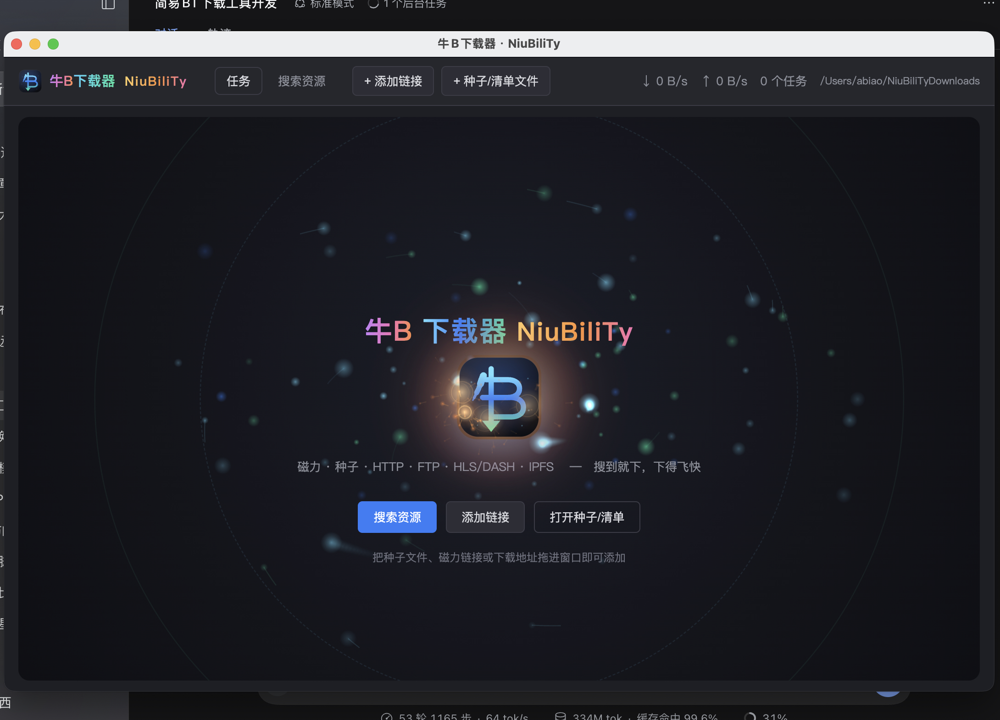

# NiuBiliTy

**English** · [中文](README_CN.md)

One download client for everything: BitTorrent, HTTP(S), FTP(S), HLS/DASH, Metalink, IPFS, eD2K and
`thunder://` / `qqdl://` / `flashget://` links — with a built-in discovery layer and
play-while-downloading.



---

## Why another downloader?

Most tools do one thing: qBittorrent speaks BitTorrent, IDM speaks HTTP, aria2 lives in a terminal.
NiuBiliTy is built around a single idea — **finding a resource and downloading it are one workflow**:

```
search (discovery) → pick a result → task (execution) → play what is already on disk
```

Every task goes through the same engine, whether it arrived as a magnet, a `.torrent`, a page URL,
a Netdisk share or a search hit.

## Features

**Downloading**

- BitTorrent / magnet (WebTorrent), file selection, partial download, seeding
- HTTP(S) with **multi-connection chunk queue** — up to 32 connections, work-stealing so one slow socket can't stall the file
- FTP(S), HLS (m3u8), DASH (mpd), Metalink, IPFS, eD2K, `thunder://` / `qqdl://` / `flashget://`
- Queue with concurrency cap, global speed limit, task list persisted across restarts
- Custom request headers (User-Agent / Referer / Cookie) for links that demand them — most Netdisks do

**Discovery**

- Built-in search gateway: apibay, dmhy, nyaa, **Prowlarr** aggregation (10 indexers), plus your own DHT index
- **Relevance filtering** — drops the hot-list fallback that trackers return when nothing matches
- **CJK ⇄ EN query expansion** — searches `进击的巨人` and `Attack on Titan` in one go
- Automatic indexer health checks every 3 hours, slow sources get pruned

**Playback**

- Play a partially downloaded file; WebTorrent fetches the pieces you seek to, on demand
- A timeline marks exactly which byte ranges are already on disk (no blind seeking into a stall)
- Built-in ffmpeg transcode path for MKV / HEVC / AV1 / DTS when Chromium cannot decode them

**Sniffing**

- Static HTML scan (fast) **and** deep scan that runs the page's JS in a hidden sandboxed browser
  (we already ship Chromium, so no puppeteer/playwright dependency)

**Netdisk**

- **Aliyun Drive** through the official open API (paste a `refresh_token`)
- **Baidu Pan** through its web API plus your Cookie (fragile by nature — see limitations)
- Everything else: paste the direct link together with UA / Referer / Cookie

**Integration**

- `magnet:` protocol handler and `.torrent` file association
- Local HTTP API on `127.0.0.1:8977` with token auth, powering the bundled browser extension
- Drag & drop files or links onto the window (Chrome/Edge and Firefox extensions included)

## Comparison

| | **NiuBiliTy** | qBittorrent | Transmission | Motrix | Free Download Manager | IDM | aria2 |
|---|---|---|---|---|---|---|---|
| BitTorrent / magnet | ✅ | ✅ | ✅ | ✅ | ✅ | ❌ | ✅ |
| HTTP(S) multi-connection | ✅ ≤32 | ❌ | ❌ | ✅ | ✅ | ✅ 8–32 | ✅ |
| FTP(S) | ✅ | ❌ | ❌ | ❌ | ✅ | ✅ | ✅ |
| HLS / DASH | ✅ | ❌ | ❌ | ❌ | ❌ | ⚠️ sniff only | ❌ |
| Metalink / IPFS / eD2K / thunder | ✅ | ❌ | ❌ | ❌ | ❌ | ❌ | ⚠️ Metalink |
| Built-in aggregated search | ✅ | ⚠️ plugins | ❌ | ❌ | ❌ | ❌ | ❌ |
| Play while downloading + transcode | ✅ | ❌ | ❌ | ❌ | ❌ | ❌ | ❌ |
| Netdisk (Aliyun / Baidu) | ✅ | ❌ | ❌ | ❌ | ❌ | ❌ | ❌ |
| Browser integration | ✅ extension | ❌ | ❌ | ❌ | ✅ | ✅ | ❌ |
| GUI | ✅ | ✅ | ✅ | ✅ | ✅ | ✅ | ❌ CLI |
| macOS | ✅ | ✅ | ✅ | ✅ | ✅ | ❌ | ✅ |
| License | MIT | GPL-3.0 | GPL-3.0 | MIT | Freeware | Commercial | GPL-2.0 |
| Install size | ~98 MB | ~30 MB | ~15 MB | ~120 MB | ~60 MB | ~10 MB | ~5 MB |

**Where it loses:** IDM still has an edge on servers that cap *total* bandwidth per IP (no amount of
parallelism helps there), and every competitor above is far more battle-tested. This is a young project — see [Limitations](#limitations).

## Install

| Platform | File | How |
|---|---|---|
| macOS (Apple Silicon) | `牛B下载器-2.4.0-arm64.dmg` | Drag to Applications. First launch: **right-click → Open** (ad-hoc signed, not notarized) |
| Windows x64 | `牛B下载器-2.4.0-win-x64.exe` | Run the installer. Unsigned → SmartScreen: *More info → Run anyway* |
| Linux x64 | `牛B下载器-2.4.0-linux-x64.AppImage` | `chmod +x` then run |
| Linux x64 | `牛B下载器-2.4.0-linux-x64.deb` | `sudo dpkg -i`, installs to `/opt/NiuBiliTy/` |

`ffmpeg` is optional but required for transcode playback:
`brew install ffmpeg` (macOS) · `sudo apt install ffmpeg` (Linux) · `ffmpeg.exe` on `PATH` (Windows).

## Quick start

1. **Add a task** — `+ 添加链接` and paste a magnet or URL, or drop a `.torrent` onto the window
2. **Search** — `搜索资源` → type a keyword → pick a result → it becomes a normal task
3. **Play while downloading** — expand a task, hit `▶` on a video file; the timeline shows downloaded ranges
4. **Settings** (`⚙ 设置`) — concurrency, per-task connections, global speed limit, extension token
5. **Netdisk** (`☁ 网盘`) — paste an Aliyun `refresh_token` or a Baidu Cookie, browse, download

Browser extensions: load `extension/chrome` (Chrome/Edge) or `extension/firefox` (Firefox) as an unpacked extension. For Safari on macOS, run `bash extension/build-safari.sh` and follow [the Safari install guide](./extension/README.md#safari-install-macos). Paste the token from `⚙ 设置`. Right-click any link / video / page → *Send to NiuBiliTy*.

## Architecture

```
renderer (HTML/CSS/JS)  ──IPC──▶  main process (Node)
                                   ├─ tasks.js         unified task manager (bt/http/ftp/hls/dash/…)
                                   ├─ net/*            one adapter per protocol
                                   ├─ search/          gateway + providers (discovery layer)
                                   ├─ stream-server    HTTP Range server for play-while-downloading
                                   ├─ indexer-monitor  Prowlarr health checks
                                   └─ local API        127.0.0.1:8977 (extension / CLI)
```

The discovery layer never leaks into the protocol adapters: providers only emit `SearchResult`s, and
`gateway.toTask(resultId)` hands off to the same `TaskManager.add()` a pasted magnet uses.

## Build from source

```bash
cd micro-torrent
npm install          # postinstall patches uint8-util (see shim.cjs)
npm start            # dev

npm run build:mac    # .dmg + .zip (arm64)
npm run build:win    # NSIS .exe (x64)
npm run build:linux  # AppImage + .deb (x64)

npm run test:unit    # unit tests + indexer tests
npm run test         # 17 isolated e2e suites
```

Cross-built installers are untested on real Windows/Linux — `.github/workflows/build.yml` builds all
three on native runners and uploads the artifacts.

## Limitations

- **Not notarized / not code-signed** — macOS needs one right-click, Windows shows SmartScreen
- **Deep sniffing needs a real page load** — ~5 s, no login state (it uses an isolated sandbox, not your cookies)
- **Baidu Pan is best-effort** — Cookie based, will break, third-party clients carry account risk
- **Quark / 115 / Tianyi** have no public API — direct link + custom headers only
- **HTTP connections capped at 32** and scaled by file size, not dynamically rebalanced like IDM
- macOS-only extras: Dock icon and launchd auto-start scripts

## License

This project is licensed under the [MIT License](LICENSE). Third-party components
(Electron, WebTorrent, ffmpeg, and others) retain their respective licenses.
