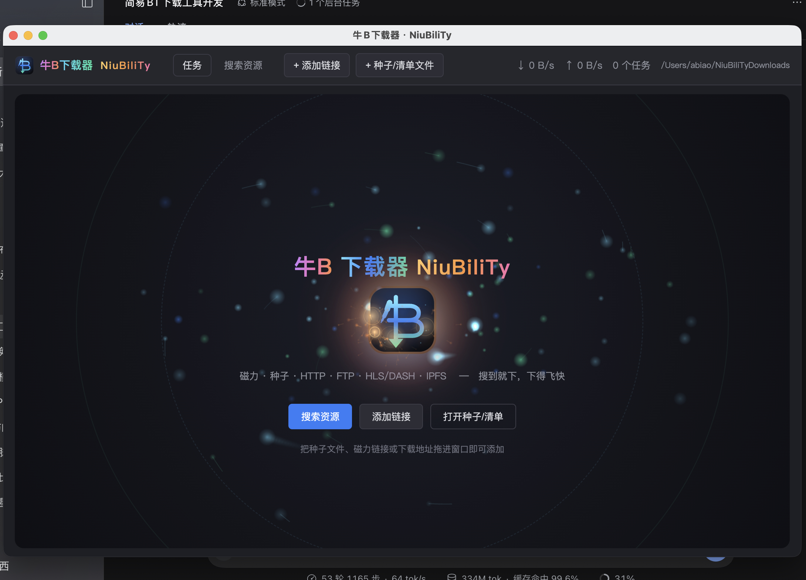

# NiuBiliTy 牛B下载器

[English](README.md) · **中文**

[下载最新安装包](https://github.com/abiao-github/Niubility/releases/latest) · Windows · macOS · Linux

一个下载器吃掉所有协议：BitTorrent、HTTP(S)、FTP(S)、HLS/DASH、Metalink、IPFS、eD2K，以及
迅雷 / 旋风 / 快车链接 —— 自带资源搜索层，还能边下边播。



---

## 为什么还要再做一个

大多数工具只干一件事：qBittorrent 管 BT、IDM 管 HTTP、aria2 在命令行里。NiuBiliTy 的核心想法很单一：
**找资源和下载资源是同一件事**。

```
搜索（发现层） → 选中结果 → 变成任务（执行层） → 已下载的部分直接播放
```

不管任务是磁力、种子、网页地址、网盘分享还是搜索结果，最后都走同一套引擎。

## 功能

**下载**

- BitTorrent / 磁力（WebTorrent 内核）、文件选择、部分下载、做种
- HTTP(S) **多连接分块队列** —— 最多 32 条连接，谁先完成谁领下一块（慢连接不会拖死整个文件）
- FTP(S)、HLS(m3u8)、DASH(mpd)、Metalink、IPFS、eD2K、`thunder://` / `qqdl://` / `flashget://`
- 队列并发上限、全局限速、任务列表重启后自动恢复
- 自定义请求头（User-Agent / Referer / Cookie），大多数网盘直链都要这玩意儿

**发现**

- 内置搜索网关：apibay、dmhy、nyaa，外加 **Prowlarr** 聚合（10 个 indexer）和自建 DHT 索引
- **相关性过滤** —— 把站点在没命中时返回的"热门榜单"兜底全部丢掉
- **中英互搜** —— 一次同时搜 `进击的巨人` 和 `Attack on Titan`
- 每 3 小时自动体检 indexer，连续两次都慢的源自动停用

**播放**

- 没下完的文件可以直接播，拖到哪 WebTorrent 就补哪的分片
- 进度条上标出**已下载的字节区间**，不会盲拖到空洞里干等
- 内置 ffmpeg 转码通道：MKV / HEVC / AV1 / DTS 这些 Chromium 播不了的，实时转成 H.264/AAC

**嗅探**

- 静态解析网页源码（快）**和**深度嗅探：在隐藏的沙箱浏览器里真正执行页面 JS
  （我们自己就带着 Chromium，不需要额外装 puppeteer/playwright）

**网盘**

- **阿里云盘**：走官方开放 API，粘一个 `refresh_token` 即可
- **百度网盘**：网页 API + 你的 Cookie（天生脆弱，见下面的限制）
- 其它网盘：粘直链 + 自定义 UA/Referer/Cookie

**集成**

- 注册 `magnet:` 协议、关联 `.torrent` 文件
- 本地 HTTP 接口 `127.0.0.1:8977`（带令牌鉴权），驱动配套浏览器扩展
- 文件 / 链接直接拖进窗口；Chrome/Edge 与 Firefox 扩展都在仓库里

## 横向对比

| | **NiuBiliTy** | qBittorrent | Transmission | Motrix | Free Download Manager | IDM | aria2 |
|---|---|---|---|---|---|---|---|
| BT / 磁力 | ✅ | ✅ | ✅ | ✅ | ✅ | ❌ | ✅ |
| HTTP 多连接 | ✅ ≤32 | ❌ | ❌ | ✅ | ✅ | ✅ 8–32 | ✅ |
| FTP(S) | ✅ | ❌ | ❌ | ❌ | ✅ | ✅ | ✅ |
| HLS / DASH | ✅ | ❌ | ❌ | ❌ | ❌ | ⚠️ 仅嗅探 | ❌ |
| Metalink / IPFS / eD2K / 迅雷 | ✅ | ❌ | ❌ | ❌ | ❌ | ❌ | ⚠️ Metalink |
| 内置聚合搜索 | ✅ | ⚠️ 插件 | ❌ | ❌ | ❌ | ❌ | ❌ |
| 边下边播 + 转码 | ✅ | ❌ | ❌ | ❌ | ❌ | ❌ | ❌ |
| 网盘（阿里 / 百度） | ✅ | ❌ | ❌ | ❌ | ❌ | ❌ | ❌ |
| 浏览器接管 | ✅ 扩展 | ❌ | ❌ | ❌ | ✅ | ✅ | ❌ |
| 图形界面 | ✅ | ✅ | ✅ | ✅ | ✅ | ✅ | ❌ 命令行 |
| macOS | ✅ | ✅ | ✅ | ✅ | ✅ | ❌ | ✅ |
| 授权 | 私有 | GPL-3.0 | GPL-3.0 | MIT | 免费 | 商业 | GPL-2.0 |
| 安装体积 | ~98 MB | ~30 MB | ~15 MB | ~120 MB | ~60 MB | ~10 MB | ~5 MB |

**打不过的地方**：如果服务器限制的是**每 IP 总带宽**（不是每连接），再多连接也没用，那种场景 IDM 依然更快；
另外上面每一个对手都比这个项目久经考验。这是个很新的项目，见「已知限制」。

## 安装

安装包在 GitHub 的[发行版（Releases）页面](https://github.com/abiao-github/Niubility/releases/latest)，不在仓库的 Code 文件列表里。

| 平台 | 下载文件 | 怎么装 |
|---|---|---|
| macOS（Apple Silicon） | `.dmg` | 拖进「应用程序」。首次打开要 **右键 → 打开**（ad-hoc 签名，未公证） |
| Windows x64 | `.exe` | 运行安装程序。未签名 → SmartScreen 提示「更多信息 → 仍要运行」 |
| Linux x64 | `.AppImage` | `chmod +x` 后直接运行 |
| Linux x64 | `.deb` | `sudo dpkg -i`，装到 `/opt/NiuBiliTy/` |
| Safari 扩展（macOS） | `NiuBiliTy-Safari-macos-arm64.zip` | 按照 [Safari 安装指南](./extension/README.md#safari-install-macos) 操作 |

`ffmpeg` 可选，但边下边播转码需要它：
`brew install ffmpeg`（macOS）· `sudo apt install ffmpeg`（Linux）· Windows 把 `ffmpeg.exe` 放进 PATH。

## 快速上手

1. **加任务** —— 点 `+ 添加链接` 粘磁力或地址，或直接把 `.torrent` 拖进窗口
2. **搜索** —— 点 `搜索资源`，输关键词，选中结果就变成普通任务
3. **边下边播** —— 展开任务，在视频文件上点 `▶`；进度条会显示已下载的区间
4. **设置**（`⚙ 设置`）—— 并发数、单任务连接数、全局限速、扩展令牌
5. **网盘**（`☁ 网盘`）—— 粘阿里云盘 `refresh_token` 或百度 Cookie，浏览后直接下

浏览器扩展：把 `extension/chrome`（或 `extension/firefox`）作为「已解压的扩展程序」加载，再到
`⚙ 设置` 里复制令牌粘进去。右键任意链接 / 视频 / 页面 → 「用牛B下载器下载」。

## 结构

```
渲染层（HTML/CSS/JS） ──IPC──▶ 主进程（Node）
                                ├─ tasks.js         统一任务管理（bt/http/ftp/hls/dash/…）
                                ├─ net/*            每种协议一个适配器
                                ├─ search/          网关 + provider（发现层）
                                ├─ stream-server    边下边播的 Range 服务
                                ├─ indexer-monitor  Prowlarr 源健康巡检
                                └─ local API        127.0.0.1:8977（扩展 / 命令行）
```

发现层不会渗进协议适配器：provider 只产出 `SearchResult`，`gateway.toTask(resultId)` 交给
`TaskManager.add()` ——和手动粘贴磁力走的是同一条路。

## 从源码构建

```bash
cd micro-torrent
npm install          # postinstall 会跑 shim.cjs 修补 uint8-util
npm start            # 开发模式

npm run build:mac    # .dmg + .zip（arm64）
npm run build:win    # NSIS 安装包（x64）
npm run build:linux  # AppImage + .deb（x64）

npm run test:unit    # 单元测试 + 索引器测试
npm run test         # 17 组隔离运行的 e2e
```

`test/` 目录保留在源码仓库中，用于回归测试和贡献者开发；打包安装程序时会排除该目录。

交叉构建出来的安装包没在目标系统上验证过 —— `.github/workflows/build.yml` 会在三个原生 runner
上分别构建并上传产物。

## 已知限制

- **未公证 / 未签名** —— macOS 要右键打开一次，Windows 会弹 SmartScreen
- **深度嗅探要真开一次页面** —— 约 5 秒，且不带登录态（用的是隔离沙箱，不是你浏览器里的 Cookie）
- **百度网盘是尽力而为** —— 基于 Cookie，会失效，第三方客户端还有账号风险
- **夸克 / 115 / 天翼** 没有公开接口，只能用直链 + 自定义请求头
- **HTTP 连接数上限 32**，按文件大小伸缩，不像 IDM 那样动态重平衡
- macOS 独有的东西：Dock 图标、launchd 自启脚本

## 授权

本项目使用 [MIT 许可证](LICENSE)。第三方组件（Electron、WebTorrent、ffmpeg 等）各自保留其许可证。
